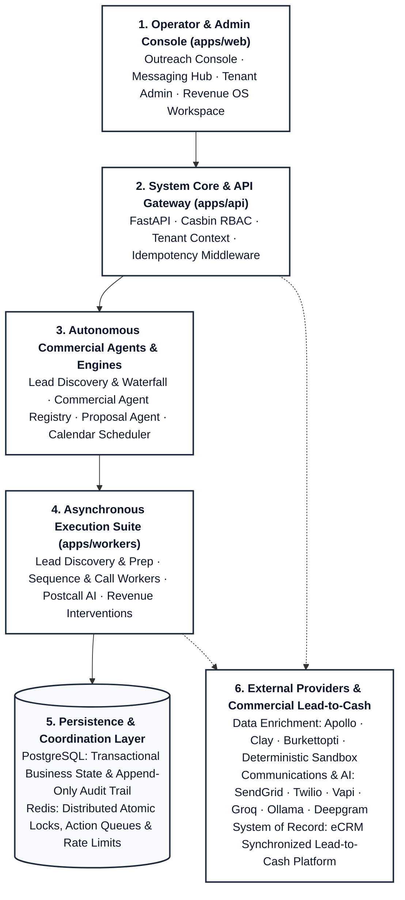

# SignalLoop Architecture Overview

This section documents the SignalLoop architecture as of 2026-10-10, encompassing the core campaign orchestration, the autonomous Commercial Agent Suite, the AI Lead Discovery & Waterfall Enrichment Engine, and the enterprise Revenue OS / eCRM integration.

Use these documents together:

- [Architecture Stories](./architecture-stories.md) explains the system in narrative form, organized by business capability and technical boundary.
- [Data Model](./data-model.md) describes the PostgreSQL and Redis responsibilities with a GitHub-renderable Mermaid ERD.
- [Process Flows](./process-flows.md) walks through the main request, approval, policy, and delivery-pipeline flows with sequence and swimlane diagrams.
- [Validation Report (2026-04-02)](./validation-report-2026-04-02.md) compares architecture docs to historical planning artifacts.
- [Draw.io Diagram Source](./diagrams/system-context.drawio) provides editable source for architecture visuals in the draw.io extension.

## System Snapshot

- `apps/api` is the active system core. It exposes FastAPI endpoints for campaigns, sequences, voice agents, calendar scheduling, autonomous commercial agents, AI lead discovery & waterfall enrichment, proposals, messaging hub, tenant administration, and platform controls.
- `apps/web` is the operator console built on React, Vite, and TanStack Router. It contains full route trees for Outreach, Messaging Hub, Tenant Admin, Platform Control Plane, and Revenue OS cross-product views.
- `apps/workers` is the production async worker execution suite. Nine specialized workers in `apps/workers/worker_app/` manage lead discovery, lead preparation, proposal generation, calendar scheduling, email sequences, voice calls, postcall AI processing, cross-tenant projections, and revenue interventions.
- `packages/` contains shared TypeScript packages (`api-client`, `event-contracts`, `shared-types`, `ui-tokens`).

## Architecture At A Glance

## Validation Snapshot (Planning vs Implementation)

| Capability Area | Module / Implementation | Current Status | Validation |
| --- | --- | --- | --- |
| Campaign intake & segmentation | `campaigns.py`, `campaign_health.py` | Complete | Full API, domain models, Playwright UI specs verified |
| Template & offer governance | `templates.py`, `offer_packs.py` | Complete | Publish lifecycle, token preview, guardrail checks active |
| Governance, policy & controls | `controls.py`, policy engine | Complete | Emergency pause/resume, quiet hours, daily caps enforced |
| Multichannel delivery loop | `sequence_worker.py`, `call_worker.py` | Complete | SendGrid, Twilio, Vapi, SMTP providers operational |
| Post-call processing & AI STT | `postcall_worker.py`, STT service | Complete | Deepgram, faster-whisper, Groq call summarization active |
| Commercial Agent Registry | `commercial_agents.py` | Complete | Slot allocation, capacity metering, multi-agent lifecycle |
| Autonomous Lead Preparation | `lead_preparation.py`, `lead_preparation_worker.py` | Complete | Versioned scoring, atomic leases, evidence briefs |
| AI Lead Discovery & Waterfall | `lead_discovery.py`, `lead_discovery_worker.py` | Complete | Multi-provider waterfall, 4-pillar AI scoring, CRM promotion |
| Generative Proposal Drafting | `proposal_agent.py`, `proposal_agent_worker.py` | Complete | Grounded drafts, review gates, eCRM handoffs |
| Autonomous Calendar Scheduling | `scheduling.py`, `calendar_scheduler_worker.py` | Complete | Meeting slot calculation, booking links, durable recovery |
| Revenue OS & eCRM Integration | `ecrm_installations.py`, `revenue_interventions.py` | Complete | Signed event sync, lead-to-cash handoff, risk mitigation |

## Current-State Architectural Themes

### 1. Governed orchestration comes before delivery automation

The repo already prioritizes campaign setup, template governance, approvals, and pause or resume controls. That tells us the product treats operational safety as a first-class concern, not an afterthought.

### 2. Request context is part of the contract

Most mutation endpoints require both `X-Workspace-Id` and `Idempotency-Key`. Correlation IDs are also propagated through middleware. This creates a stable foundation for auditability and future async execution.

### 3. Persistence is intentionally split by responsibility

PostgreSQL carries both mutable business state and append-oriented audit records (in the `audit_events` table with a JSONB payload column), while Redis is reserved for ephemeral coordination. The split is visible in code and in the latest Epic 2 migration.

### 4. The worker architecture is emerging, not finished

The presence of `outbox_events`, `action_queue`, `provider_credentials`, `provider_event_logs`, and the worker enforcement gate signals a clear target architecture. The docs in this folder treat that as an in-progress implementation path, not a completed subsystem.

## Reading Order

If you are new to the codebase, read in this order:

1. [Architecture Stories](./architecture-stories.md)
2. [Data Model](./data-model.md)
3. [Process Flows](./process-flows.md)
4. [Validation Report (2026-04-02)](./validation-report-2026-04-02.md)
