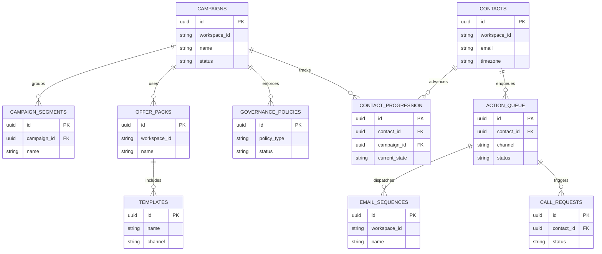

# SignalLoop Data Model

SignalLoop uses a polyglot persistence model:

- PostgreSQL stores mutable business state, transactional relationships, and append-oriented audit history (the `audit_events` table with a JSONB payload column).
- Redis is reserved for coordination, rate limiting, and short-lived operational state.

## Data Ownership

| Store | Responsibility | Examples |
| --- | --- | --- |
| PostgreSQL | Source of truth for operational records and audit history | campaigns, templates, approvals, policies, contact progression, action queue, `audit_events` |
| Redis | Ephemeral coordination | rate limiting, pause state fan-out, future worker coordination |

## Core PostgreSQL Domains

### Campaign Intake

- `campaigns`
- `campaign_contact_imports`
- `campaign_contact_staging`
- `campaign_segments`
- `campaign_segment_rules`
- `campaign_channel_strategy`

These tables support campaign creation, CSV import, mapping, preview, segmentation, and strategy assignment.

### Template and Offer Library

- `templates`
- `template_versions`
- `template_tokens`
- `offer_packs`
- `offer_pack_versions`
- `offer_pack_template_bindings`

These tables implement a versioned content library with publish-state tracking and guardrail compliance.

### Governance and Approvals

- `governance_policies`
- `campaign_policy_bindings`
- `policy_approval_requests`
- `global_control_state`

These tables support admin policy management, approval workflows, and emergency stop style controls.

### Delivery Pipeline & Engagement

- `contacts`
- `contact_progression`
- `contact_state_history`
- `outbox_events`
- `action_queue`
- `email_sequences`
- `sequence_steps`
- `contact_sequence_states`
- `email_suppressions`
- `call_requests`
- `call_sessions`
- `voice_scripts`
- `provider_credentials`
- `provider_event_logs`

These tables support high-volume email sequences, outbound voice calls, provider credential management, and deliverability enforcement.

### Commercial Agent Registry & Metering

- `agent_catalog_definitions`
- `agent_plan_entitlements`
- `agent_deployments`
- `agent_capacity_overrides`
- `agent_usage_ledgers`
- `agent_dependencies`
- `agent_lifecycle_events`

These tables govern independently sellable autonomous agents, manage slot allocations, and meter type-specific daily capacity.

### AI Lead Discovery & Waterfall Enrichment

- `discovered_leads`
- `discovery_search_query_logs`

These tables store discovered prospects, firmographic intelligence, waterfall provider source tracking, 4-pillar scores, and CRM promotion links.

### Lead Preparation & Scoring

- `lead_scoring_policies`
- `lead_score_versions`
- `lead_preparation_jobs`
- `lead_preparation_packages`
- `lead_evidence_items`
- `lead_outcome_observations`

These tables manage autonomous lead scoring, policy versioning, atomic worker lease locks, and contextual sales evidence packaging.

### Governed Proposal Drafting

- `proposal_generation_jobs`
- `proposal_generation_receipts`
- `proposal_draft_reviews`
- `proposal_email_handoffs`
- `proposal_grounding_sources`

These tables track generative proposal versions, review gates, account signal grounding, and eCRM handoffs.

### Calendar Scheduling

- `calendar_meeting_types`
- `calendar_provider_bindings`
- `calendar_booking_jobs`
- `calendar_booking_receipts`
- `scheduling_offers`
- `scheduling_confirmations`

These tables model autonomous meeting slot discovery, booking link generation, timezone reconciliation, and immutable calendar receipts.

### Revenue OS & eCRM Integration

- `revenue_signal_records`
- `revenue_intervention_records`
- `revenue_intervention_transitions`
- `ecrm_installation_bindings`
- `revenue_os_installation_projections`

These tables track cross-product signals, intervention lifecycles, and signed event synchronizations with eCRM.

## Entity-Relationship Model (Mermaid ERD)



### Core Entity Definitions

```
CAMPAIGNS {
    uuid id PK
    string workspace_id
    string name
    string status
    uuid created_by
    datetime created_at
}
CONTACTS {
    uuid id PK
    string workspace_id
    string email
    string phone
    string first_name
    string last_name
    string timezone
    datetime created_at
}
CONTACT_PROGRESSION {
    uuid id PK
    uuid contact_id FK
    uuid campaign_id FK
    string current_state
    datetime updated_at
}
EMAIL_SEQUENCES {
    uuid id PK
    string workspace_id
    string name
    string status
    int total_steps
}
SEQUENCE_STEPS {
    uuid id PK
    uuid sequence_id FK
    int step_order
    int delay_hours
    uuid template_id FK
}
CALL_REQUESTS {
    uuid id PK
    string workspace_id
    uuid contact_id FK
    uuid voice_script_id FK
    string status
    datetime scheduled_for
}
CALL_SESSIONS {
    uuid id PK
    uuid call_request_id FK
    string provider_call_id
    int duration_seconds
    string outcome
    string recording_url
}
DISCOVERED_LEADS {
    uuid id PK
    string workspace_id
    string company_name
    string company_domain
    string email
    string title
    int fit_score
    string fit_band
    string source_provider
    string match_confidence
    bool is_promoted
    uuid promoted_contact_id FK
}
AGENT_DEPLOYMENTS {
    uuid id PK
    string tenant_id
    string agent_type
    string deployment_status
    int daily_capacity_limit
    datetime activated_at
}
AGENT_USAGE_LEDGERS {
    uuid id PK
    uuid deployment_id FK
    date billing_date
    int consumed_units
    string usage_state
}
LEAD_PREPARATION_JOBS {
    uuid id PK
    string workspace_id
    uuid contact_id FK
    uuid policy_id FK
    string status
    string lease_owner
    datetime lease_expires_at
}
PROPOSAL_GENERATION_JOBS {
    uuid id PK
    string workspace_id
    uuid account_id FK
    string status
    int version_number
    jsonb grounding_sources
}
CALENDAR_BOOKING_JOBS {
    uuid id PK
    string workspace_id
    uuid contact_id FK
    string status
    datetime meeting_start
    datetime meeting_end
}
CALENDAR_BOOKING_RECEIPTS {
    uuid id PK
    uuid booking_job_id FK
    string external_event_id
    string meeting_url
    datetime confirmed_at
}
```

## Audit Event Storage

### `audit_events` (PostgreSQL)

This table is written directly by API routes and background worker services through `append_audit_event(...)` (defined in `apps/api/app/domain/audit/audit_events.py`). It captures actor-driven business actions such as campaign creation, policy activation, sequence step dispatches, agent deployments, proposal reviews, and approval state changes. The payload is stored in a JSONB column to keep the shape flexible while preserving relational query and indexing capabilities.

Shape of an audit record:

```json
{
  "event_name": "lead_discovery.promoted",
  "workspace_id": "workspace-123",
  "actor_id": "user-456",
  "actor_role": "operator",
  "payload": {
    "discovered_lead_id": "8f83196c-...",
    "contact_id": "4b6b6100-...",
    "company_domain": "apexnexus.io",
    "fit_score": 85,
    "fit_band": "HIGH_FIT",
    "enrolled_sequence_id": "seq-789"
  },
  "created_at": "2026-10-10T14:32:00Z"
}
```

Indexes are maintained on `(workspace_id, created_at)`, `(event_name, created_at)`, and `(actor_id)` for high-speed audit-trail queries and regulatory compliance exports.

---

## State Models

SignalLoop models the core operational domains as formal, auditable finite-state machines. Every state transition writes an immutable event into PostgreSQL and enforces tenant-level policy constraints.

### 1. Contact Progression State Machine (`ContactProgressionState`)

Tracks a contact's commercial relationship from initial intake through final revenue handoff.

```mermaid
%%{init: {
  "theme": "base",
  "themeVariables": {
    "fontFamily": "Inter, -apple-system, BlinkMacSystemFont, 'Segoe UI', Roboto, sans-serif",
    "fontSize": "12px",
    "lineColor": "#64748b",
    "stateBkg": "#ffffff",
    "stateBorder": "#0f172a"
  },
  "themeCSS": ".edgeLabel span { background-color: #f1f5f9; color: #0f172a; padding: 2px 6px; border-radius: 4px; border: 1px solid #cbd5e1; font-weight: 500; font-size: 11px; } .state-title { color: #0f172a; font-weight: 700; } text { fill: #0f172a !important; }"
}}%%
stateDiagram-v2
    direction TB

    [*] --> inbox: Intake / Promotion
    inbox --> nurturing: Enroll Cadence
    nurturing --> engaged: Open / Click
    engaged --> replied: Inbound Reply
    replied --> booked: Meeting Booked
    booked --> handed_off: Handoff to eCRM
    handed_off --> [*]

    inbox --> opted_out: Unsubscribe
    nurturing --> opted_out: Unsubscribe
    engaged --> opted_out: Unsubscribe
    replied --> opted_out: Unsubscribe
    opted_out --> [*]
```



#### Progression Transitions & Triggers

| Current State | Next State | Trigger / Event | Guard / Policy Check | System Action |
| --- | --- | --- | --- | --- |
| `[*]` | `inbox` | CSV import, API create, or Lead Discovery promotion | Suppression check passed, workspace active | Inserts `contacts` row, initializes `contact_progression` |
| `inbox` | `nurturing` | Sequence enrollment or campaign launch | Quiet hours, daily caps, valid sender credentials | Enqueues first action into `action_queue` |
| `nurturing` | `engaged` | Webhook from SendGrid/provider (`open`, `click`) | Event verification signature valid | Updates contact engagement score, writes `audit_events` |
| `engaged` | `replied` | Inbound email or chat response detected | Sentiment & intent analysis | Pauses automated cadence steps, alerts assigned operator |
| `replied` | `booked` | Calendar booking confirmed | Verified calendar receipt issued | Creates `calendar_booking_receipts`, marks milestone |
| `booked` | `handed_off` | Proposal approved or deal accepted | eCRM installation connected | Sends signed event packet to eCRM, creates commercial record |
| Any active | `opted_out` | Unsubscribe link clicked, DNC policy match, spam complaint | Immediate execution (hard gate) | Writes `email_suppressions`, terminates sequence enrollments |

---

### 2. Campaign Operational Lifecycle (`CampaignStatus`)

Controls campaign progression, audience staging, approvals, and emergency pause controls.

```mermaid
%%{init: {
  "theme": "base",
  "themeVariables": {
    "fontFamily": "Inter, -apple-system, BlinkMacSystemFont, 'Segoe UI', Roboto, sans-serif",
    "fontSize": "12px",
    "lineColor": "#64748b",
    "stateBkg": "#ffffff",
    "stateBorder": "#0f172a"
  },
  "themeCSS": ".edgeLabel span { background-color: #f1f5f9; color: #0f172a; padding: 2px 6px; border-radius: 4px; border: 1px solid #cbd5e1; font-weight: 500; font-size: 11px; } .state-title { color: #0f172a; font-weight: 700; } text { fill: #0f172a !important; }"
}}%%
stateDiagram-v2
    direction TB

    [*] --> draft: Campaign Intake
    draft --> running: Approved & Launched
    running --> paused: Pause / Caps / Quiet Hours
    paused --> running: Resumed / Schedule
    running --> completed: All Steps Delivered
    completed --> archived: Archived
    archived --> [*]
```



- **`draft`:** Operator defines campaign parameters, uploads CSV audience, maps fields, and configures channel strategies.
- **`running`:** Sequence worker and call worker dequeue actions, respecting quiet hours and daily throughput caps.
- **`paused`:** Triggered manually via the **Controls** screen, automatically during quiet hours, or via an emergency global stop. All outbound dispatches freeze immediately.
- **`completed`:** All contacts in audience reached terminal step or conversion milestone.
- **`archived`:** Read-only historical campaign for compliance audit.

---

### 3. AI Lead Discovery & Waterfall Qualification Pipeline

Governs external prospect sourcing, data enrichment, AI multi-dimensional scoring, and CRM promotion.

```mermaid
%%{init: {
  "theme": "base",
  "themeVariables": {
    "fontFamily": "Inter, -apple-system, BlinkMacSystemFont, 'Segoe UI', Roboto, sans-serif",
    "fontSize": "12px",
    "lineColor": "#64748b",
    "stateBkg": "#ffffff",
    "stateBorder": "#0f172a"
  },
  "themeCSS": ".edgeLabel span { background-color: #f1f5f9; color: #0f172a; padding: 2px 6px; border-radius: 4px; border: 1px solid #cbd5e1; font-weight: 500; font-size: 11px; } .state-title { color: #0f172a; font-weight: 700; } text { fill: #0f172a !important; }"
}}%%
stateDiagram-v2
    direction TB

    [*] --> Discovered: ICP Search
    Discovered --> WaterfallEnrichment: Provider Query
    WaterfallEnrichment --> EntityResolution: Normalize & Match
    EntityResolution --> AIScoring: 4-Pillar Score

    AIScoring --> HotOpportunity: Score >= 85
    AIScoring --> HighFit: Score 70-84
    AIScoring --> Nurture: Score 50-69
    AIScoring --> Unqualified: Score < 50

    HotOpportunity --> PromotedToCRM: 1-Click Promote
    HighFit --> PromotedToCRM: 1-Click Promote
    Nurture --> Watchlist: Saved Search
    
    PromotedToCRM --> [*]: Enrolled in Cadence
    Watchlist --> [*]
    Unqualified --> [*]
```



#### Scoring Pillars (100 Points Total)

1. **Firmographic Fit (35 points):** Industry vertical, annual revenue bracket, employee count range.
2. **Intent & Trigger Signals (30 points):** Active search intent, recent executive hiring, tech modernization signals.
3. **Role Authority (20 points):** Decision-maker seniority level (C-suite, VP, Director).
4. **Data Completeness (15 points):** Direct dial phone verified, validated corporate email, verified domain.

---

### 4. Autonomous Commercial Agent Lifecycle & Capacity Metering

Manages the lifecycle of task-specific autonomous agent deployments and meters their daily capacity.

```mermaid
%%{init: {
  "theme": "base",
  "themeVariables": {
    "fontFamily": "Inter, -apple-system, BlinkMacSystemFont, 'Segoe UI', Roboto, sans-serif",
    "fontSize": "12px",
    "lineColor": "#64748b",
    "stateBkg": "#ffffff",
    "stateBorder": "#0f172a"
  },
  "themeCSS": ".edgeLabel span { background-color: #f1f5f9; color: #0f172a; padding: 2px 6px; border-radius: 4px; border: 1px solid #cbd5e1; font-weight: 500; font-size: 11px; } .state-title { color: #0f172a; font-weight: 700; } text { fill: #0f172a !important; }"
}}%%
stateDiagram-v2
    direction TB

    [*] --> draft: Configure
    draft --> deploying: Allocate Slot
    deploying --> active: Health Verified
    active --> paused: Pause / Policy
    paused --> active: Operator Resume
    active --> disabled: Plan Expired
    disabled --> terminated: Slot Reclaimed
    terminated --> [*]
```



#### Agent Capacity States (`AgentUsageState`)

- **`within_capacity`:** Consumed units < 80% of daily limit. Agent runs without restriction.
- **`near_capacity`:** Consumed units between 80% and 99%. Warning telemetry dispatched to workspace admins.
- **`exhausted`:** Daily capacity reached (100%). New autonomous tasks queued until billing-day boundary reset.
- **`throttled`:** Rate limit applied due to provider quota or excessive concurrency.

---

### 5. Governed Proposal Generation Lifecycle (`ProposalJobStatus`)

Ensures generative proposals are strictly grounded in account signals and customer pricing policies before commercial dispatch.

```mermaid
%%{init: {
  "theme": "base",
  "themeVariables": {
    "fontFamily": "Inter, -apple-system, BlinkMacSystemFont, 'Segoe UI', Roboto, sans-serif",
    "fontSize": "12px",
    "lineColor": "#64748b",
    "stateBkg": "#ffffff",
    "stateBorder": "#0f172a"
  },
  "themeCSS": ".edgeLabel span { background-color: #f1f5f9; color: #0f172a; padding: 2px 6px; border-radius: 4px; border: 1px solid #cbd5e1; font-weight: 500; font-size: 11px; } .state-title { color: #0f172a; font-weight: 700; } text { fill: #0f172a !important; }"
}}%%
stateDiagram-v2
    direction TB

    [*] --> drafting: Intent / Trigger
    drafting --> grounding: Signals & Pricing
    grounding --> generated: LLM Synthesis
    generated --> under_review: Submit to Gate
    under_review --> approved: Operator Sign-Off
    under_review --> rejected: Request Rework
    rejected --> drafting: Re-Ground Edits
    approved --> handed_off: Signed Dispatch
    handed_off --> [*]
```



- **Review Gate:** Proposals cannot be dispatched directly to prospects or eCRM without explicit approval or policy-permitted supervisory autonomy.
- **Grounding Evidence:** Every line item maintains a deterministic link back to approved offer packs and pricing rules.

---

### 6. Autonomous Calendar Scheduling Lifecycle (`SchedulingRequestStatus`)

Orchestrates meeting slot discovery, booking links, and immutable receipt reconciliation.

```mermaid
%%{init: {
  "theme": "base",
  "themeVariables": {
    "fontFamily": "Inter, -apple-system, BlinkMacSystemFont, 'Segoe UI', Roboto, sans-serif",
    "fontSize": "12px",
    "lineColor": "#64748b",
    "stateBkg": "#ffffff",
    "stateBorder": "#0f172a"
  },
  "themeCSS": ".edgeLabel span { background-color: #f1f5f9; color: #0f172a; padding: 2px 6px; border-radius: 4px; border: 1px solid #cbd5e1; font-weight: 500; font-size: 11px; } .state-title { color: #0f172a; font-weight: 700; } text { fill: #0f172a !important; }"
}}%%
stateDiagram-v2
    direction TB

    [*] --> detected: Intent Recognized
    detected --> slots_offered: Windows Calculated
    slots_offered --> link_generated: Booking Link Issued
    link_generated --> booking_confirmed: Slot Selected
    booking_confirmed --> calendar_synced: Receipt Created
    calendar_synced --> [*]
    
    slots_offered --> expired: Timeout
    link_generated --> cancelled: Cancelled
    expired --> [*]
    cancelled --> [*]
```



---

## Operational Storage & Concurrency Guarantees

1. **Transactional Integrity (PostgreSQL):**
   - All state transitions mutate operational rows within database transactions and write corresponding `audit_events` rows atomically.
   - Row-level multitenant isolation is strictly backstopped by `workspace_id` on all operational entities and `tenant_id` on administrative entities.

2. **Distributed Coordination & Atomic Leases (Redis):**
   - Long-running workers (`lead_preparation_worker`, `lead_discovery_worker`, `proposal_agent_worker`) acquire atomic distributed locks (`SET key val NX EX 300`) to guarantee that concurrent worker pods never process the same lead or job simultaneously.
   - Emergency pause signals (`pause_all_outreach`) fan out through Redis pub/sub and key expiration checks, stopping active sequence workers within milliseconds.
