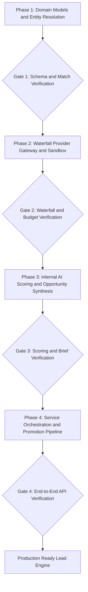

# AI Lead Discovery & Enrichment Engine Implementation Plan

> **For agentic workers:** REQUIRED SUB-SKILL: Use superpowers:subagent-driven-development (recommended) or superpowers:executing-plans to implement this plan task-by-task. Steps use checkbox (`- [ ]`) syntax for tracking.

**Goal:** Deliver an enterprise-ready, hybrid B2B Lead Discovery and AI Enrichment Engine in EmailVoice that enables prospecting by firmographic parameters (industry, revenue, size, region, tech stack), runs a multi-provider waterfall enrichment pipeline, and layers a proprietary internal AI entity-resolution and multi-dimensional scoring engine to qualify and promote high-conversion prospects directly into active sales sequences.

**Architecture:** A dedicated `lead_discovery` domain is created alongside `lead_preparation` and `prospecting`. It separates raw external data sourcing from internal intelligence:
1. **Search & Filter Matrix:** Queries leads by industry, revenue, company size, geography, job titles, and technology signals.
2. **Pluggable Waterfall Gateway:** Queries external data sources (Apollo, Clay, Burkettopti-style endpoints, or built-in deterministic sandbox) with rate-limiting, cost accounting, and graceful fallback.
3. **Internal AI Normalization & Entity Resolution:** Canonicalizes domains, cleans corporate names, resolves duplicates against existing CRM accounts, and assigns match confidence.
4. **Proprietary AI Scoring & Fit Explainer:** Evaluates firmographic fit, buying intent triggers, and technographic fit; uses LLM synthesis to generate actionable sales briefs, urgency ratings, and personalized conversation angles.
5. **Promotion Pipeline:** Converts verified discovered leads into tenant-scoped CRM contacts and enrolls them into supervised prospecting campaigns with full audit logging.

**Tech Stack:** FastAPI, SQLModel, Alembic, PostgreSQL/SQLite, Pydantic v2, Pytest, LangChain/OpenAI client abstractions.

---

## Scope and Hard Boundaries

- **Tenant Isolation:** All discovery searches, cached enrichments, and promoted leads are strictly scoped to `tenant_id` and `workspace_id`.
- **Hybrid Independence:** Sourcing works with or without external paid API keys via an enterprise Sandbox Provider with realistic simulated profiles.
- **Explainable Scoring:** The score (0–100) is broken into auditable contributions (Firmographic 35pts, Intent/Trigger 30pts, Role Authority 20pts, Data Completeness 15pts).
- **Suppression & Consent:** Suppression lists, do-not-contact domains, and active customer accounts are checked before presenting or promoting any prospect.
- **Deterministic TDD:** Every component starts with RED test specifications and reaches verified GREEN status before integration.

---

## File and Module Map

| Component | Target File | Responsibility |
|---|---|---|
| Models & Enums | `apps/api/app/domain/lead_discovery/models.py` | Data tables for queries, discovered leads, enrichment snapshots, scoring results |
| Schemas & DTOs | `apps/api/app/domain/lead_discovery/schemas.py` | Pydantic request/response models for search, enrich, score, and promote |
| Entity Resolution | `apps/api/app/domain/lead_discovery/resolution.py` | Domain canonicalization, fuzzy matching, deduplication vs CRM |
| Provider Gateway | `apps/api/app/domain/lead_discovery/providers.py` | Abstract adapter, Sandbox provider, Waterfall orchestrator, budget controls |
| AI Scoring & Synthesis | `apps/api/app/domain/lead_discovery/scoring.py` | 4-pillar scoring algorithm, trigger evaluator, AI brief & hook generation |
| Service Layer | `apps/api/app/domain/lead_discovery/service.py` | High-level orchestrator for search, enrichment, scoring, and promotion |
| HTTP API Routes | `apps/api/app/api/routes/lead_discovery.py` | REST endpoints for search, enrichment, AI analysis, and promotion |
| Router Registration | `apps/api/app/api/main.py` | Mounts lead discovery routes into FastAPI router |
| Model Discovery | `apps/api/app/models.py` | Imports SQLModel classes for migration & metadata |
| Unit & Integration Tests | `apps/api/tests/domain/test_lead_discovery.py` | Complete TDD test suite covering all phases and edge cases |

---

## Milestones and Gates

---

## Phase 1: Domain Models, Enums, and Entity Resolution (TDD)

- [x] **Task 1.1: Write RED tests for models and entity resolution**
  - File: `apps/api/tests/domain/test_lead_discovery.py`
  - Tests for domain canonicalization (`https://www.corp.acme.co.uk/about` -> `acme.co.uk`), corporate suffix stripping, fuzzy similarity, duplicate detection against existing CRM contacts, and confidence grading.
- [x] **Task 1.2: Implement `lead_discovery/models.py` and `lead_discovery/schemas.py`**
  - Define `DiscoverySearchCriteria`, `CompanyFirmographics`, `DiscoveredLead`, `EnrichmentSourceRecord`, `LeadMatchConfidence`, `LeadDiscoveryScore`.
- [x] **Task 1.3: Implement `lead_discovery/resolution.py`**
  - Implement domain extraction, normalization algorithms, deduplication against CRM records, and collision resolution.
- [x] **Task 1.4: Verify Phase 1 tests GREEN**

---

## Phase 2: Waterfall Provider Gateway & Sandbox Engine (TDD)

- [x] **Task 2.1: Write RED tests for provider gateway & waterfall fallback**
  - Tests for provider registration, fallback when Provider A has missing data or rate limit, cost ledger calculation, and sandbox search generation matching filters.
- [x] **Task 2.2: Implement `lead_discovery/providers.py`**
  - Abstract base `DiscoveryProviderAdapter`.
  - `SandboxDiscoveryProvider` with realistic data generation based on industry, revenue, size, region, and role criteria.
  - `WaterfallDiscoveryGateway` coordinating multiple providers with quota limits, timeout protection, and telemetry.
- [x] **Task 2.3: Verify Phase 2 tests GREEN**

---

## Phase 3: Internal AI Multi-Dimensional Scoring & Opportunity Briefs (TDD)

- [x] **Task 3.1: Write RED tests for AI scoring & opportunity synthesis**
  - Tests for 4-pillar scoring (Firmographic fit, Intent/Trigger fit, Role authority, Completeness).
  - Tests for AI brief generation (company summary, key pain points, tailored conversation starters for cold email & voice dialer).
- [x] **Task 3.2: Implement `lead_discovery/scoring.py`**
  - Deterministic qualification rules + algorithmic scoring matrix.
  - LLM synthesis prompt & parser with deterministic fallback for offline/test environments.
  - Fit category assignment (`HOT_OPPORTUNITY`, `HIGH_FIT`, `NURTURE`, `UNQUALIFIED`).
- [x] **Task 3.3: Verify Phase 3 tests GREEN**

---

## Phase 4: Service Orchestrator, Promotion Pipeline & API Routes (TDD)

- [x] **Task 4.1: Write RED tests for service orchestration, promotion, and REST endpoints**
  - Tests for full lifecycle: Search -> Waterfall Enrich -> AI Score -> Promote to Contact with sequence enrollment.
  - Tests for suppression exclusion and workspace isolation.
- [x] **Task 4.2: Implement `lead_discovery/service.py`**
  - High-level coordinator connecting Gateway, Entity Resolution, Scoring, and CRM persistence.
- [x] **Task 4.3: Implement `apps/api/app/api/routes/lead_discovery.py` & register in `apps/api/app/api/main.py`**
  - Endpoints:
    - `POST /api/v1/lead-discovery/search`
    - `POST /api/v1/lead-discovery/enrich`
    - `POST /api/v1/lead-discovery/score`
    - `POST /api/v1/lead-discovery/promote`
- [x] **Task 4.4: Run full end-to-end test suite GREEN**
- [x] **Task 4.5: Document execution report and request final user approval**

---

## Parallel Production Hardening (Completed)

- [x] **Track 1: Production Database Migration (Alembic)**
  - Migration `p1_lead_discovery_engine_20261010` created with tables `discovered_leads` and `discovery_search_query_logs`.
- [x] **Track 2: Autonomous Worker Poller (`apps/workers`)**
  - Worker `lead_discovery_worker.py` created and registered in `main.py` with 300s batch polling.
- [x] **Track 3: Pluggable Waterfall Providers & Ingestion Webhooks**
  - Adapters for Burkettopti (`leadspti`), Apollo, Clay, and Sandbox; webhook endpoint `/webhooks/{provider}`.
- [x] **Track 4: Frontend Discovery Console (`apps/web`)**
  - Full UI at `/lead-discovery` with ICP filter matrix, AI fit score badges, opportunity briefs, and one-click CRM promotion.
